<p align="center">
  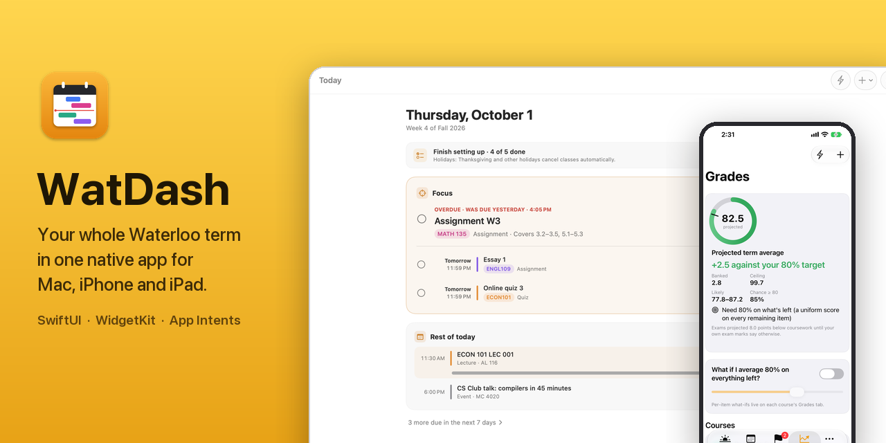
</p>

# WatDash

A native dashboard for a University of Waterloo term, on Mac, iPhone and
iPad: every class, deadline, quiz and office hour in one place, a grade engine
that tracks the **80% cumulative average** a sixth course needs, and study
pages made by Claude Code from your own course folders. Almost nothing is
typed by hand.


[](LICENSE)

Companion to WatAlarm (iOS alarms before class). Same conventions: generated
Xcode project, a hand-rolled RFC 5545 parser, and pure logic verified by plain
`swiftc` checks.

## Screenshots

<p align="center">
  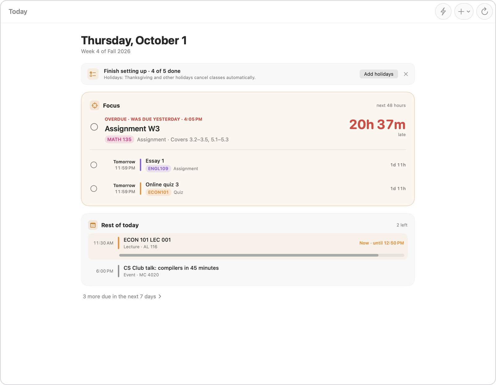
</p>

<table>
  <tr>
    <td width="50%">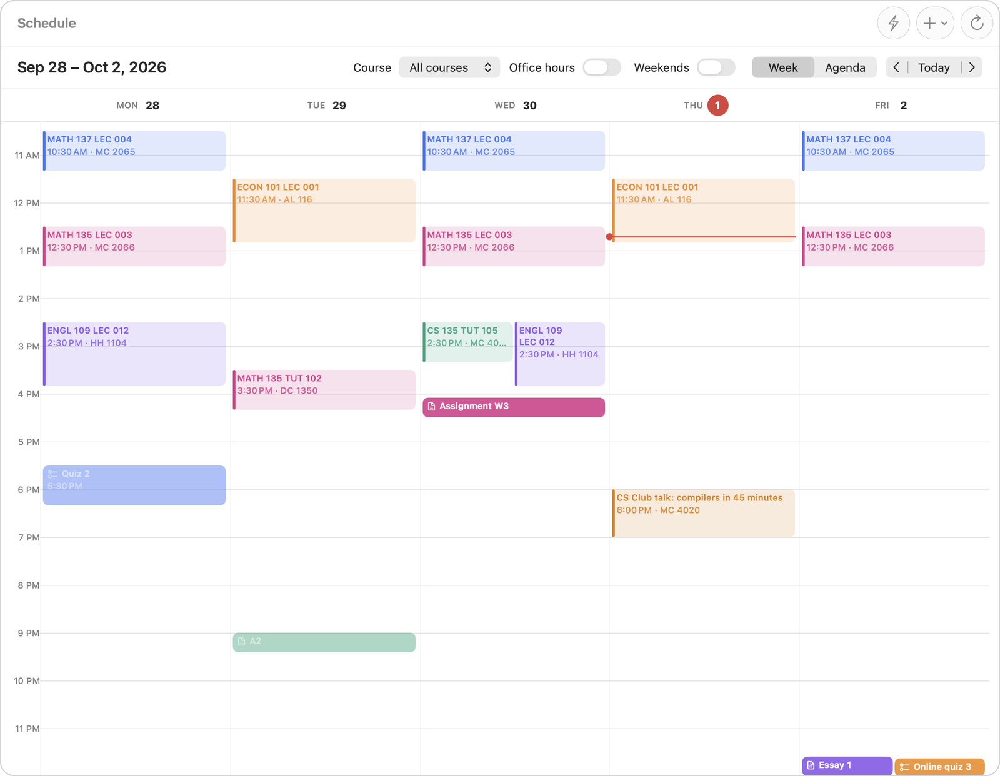</td>
    <td width="50%">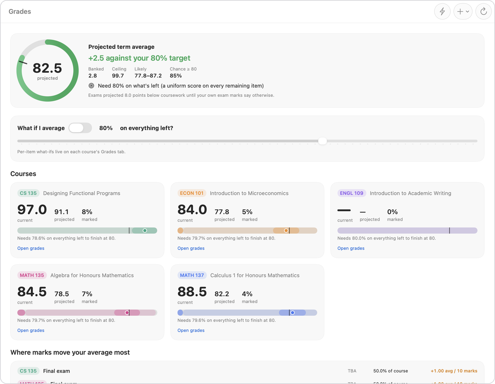</td>
  </tr>
  <tr>
    <td align="center"><b>Schedule</b>: week grid with a live "now" line</td>
    <td align="center"><b>Grades</b>: projected average against the 80% target</td>
  </tr>
  <tr>
    <td width="50%">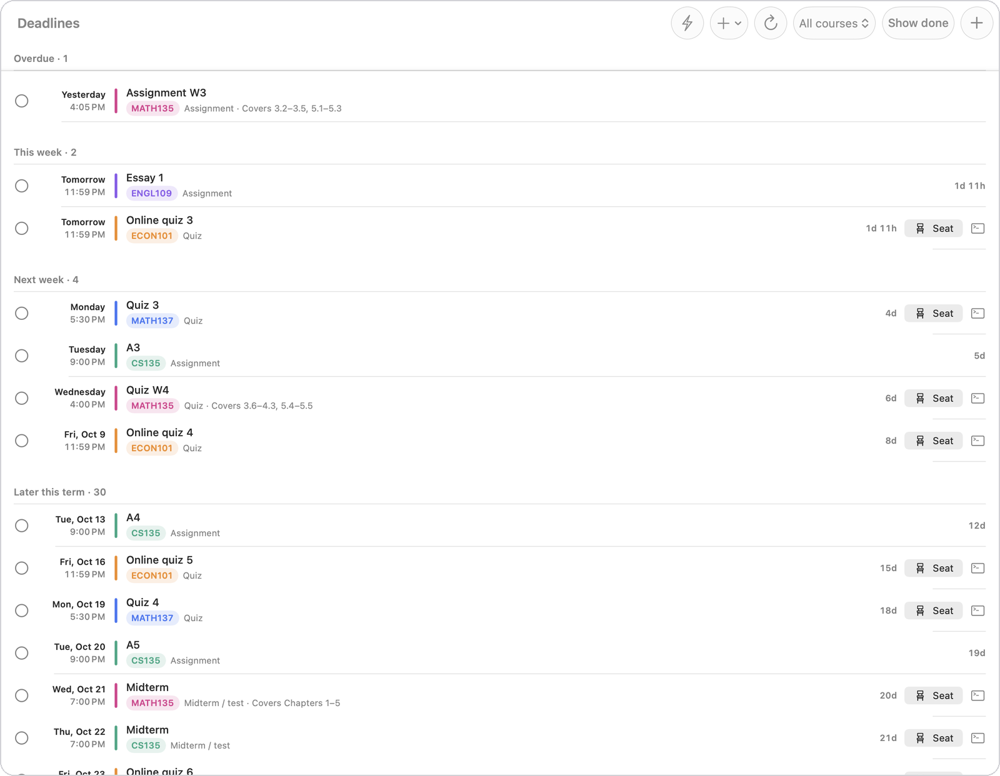</td>
    <td width="50%">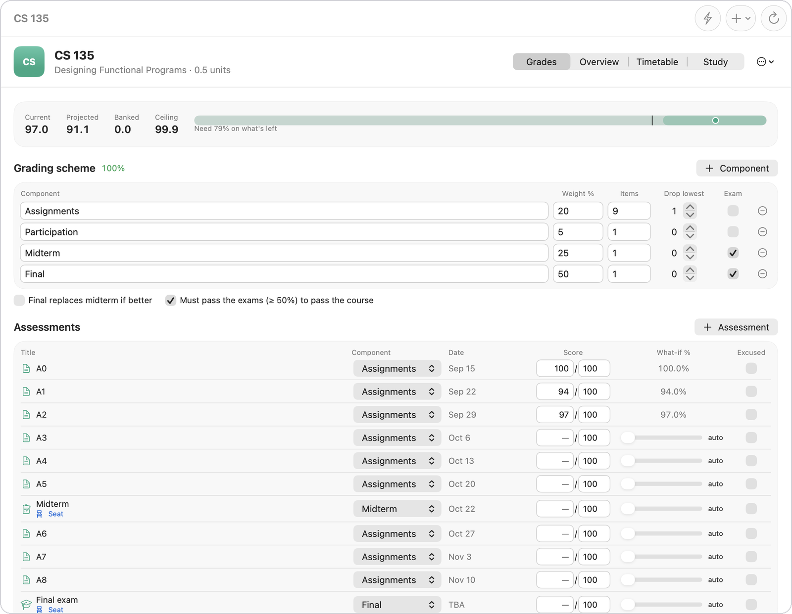</td>
  </tr>
  <tr>
    <td align="center"><b>Deadlines</b>: seats on Odyssey and study prompts</td>
    <td align="center"><b>Course</b>: grading scheme and per-item what-ifs</td>
  </tr>
</table>

<p align="center">
  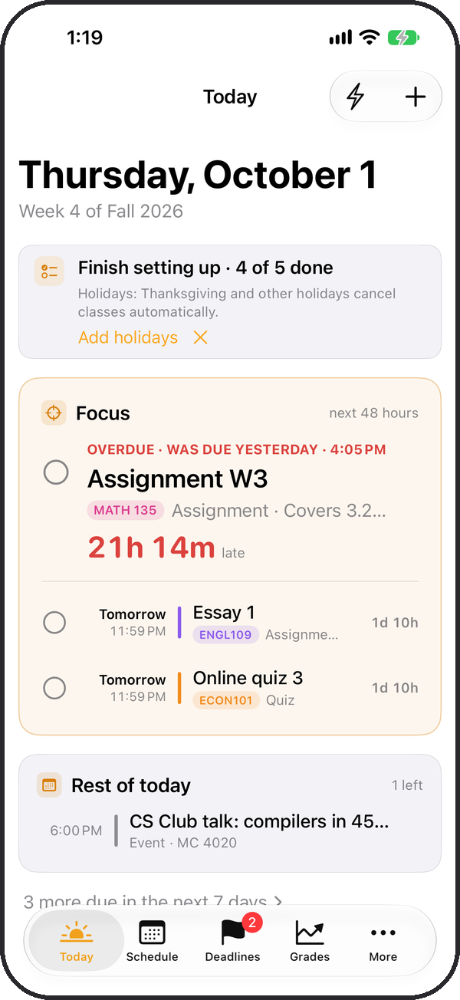
  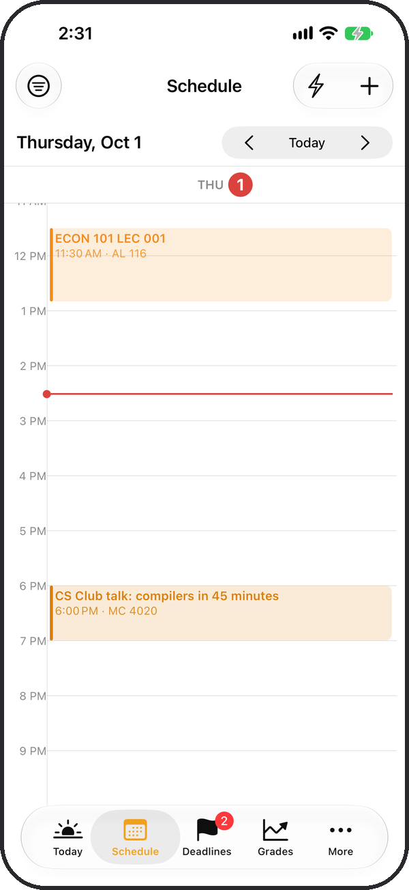
  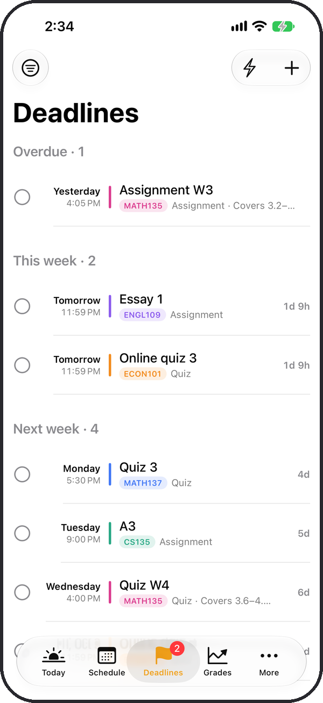
  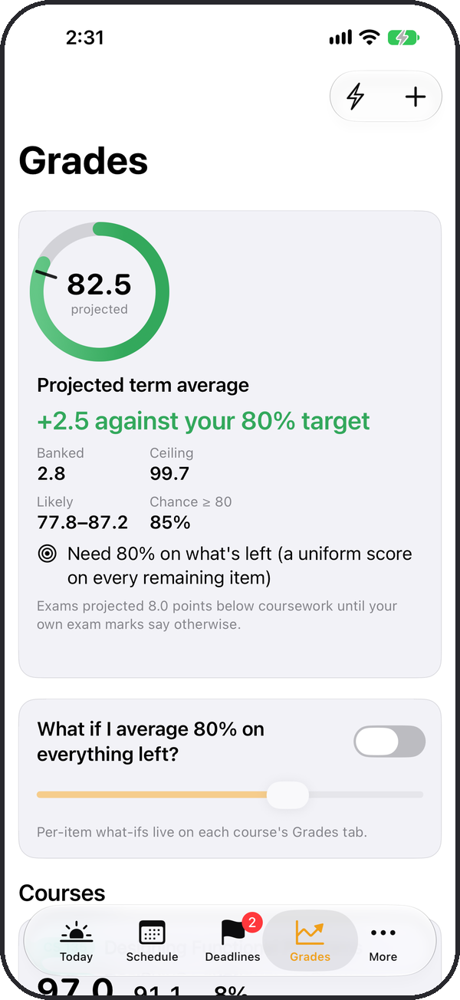
</p>
<p align="center">
  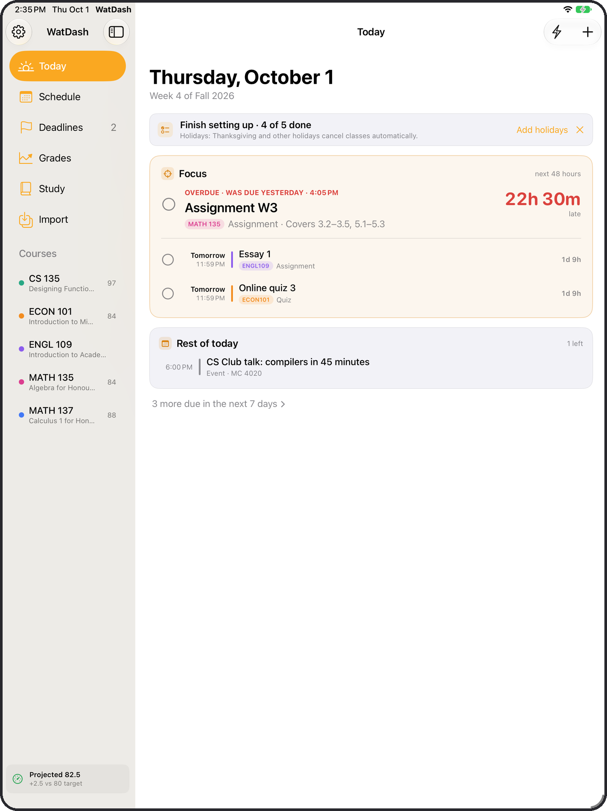
  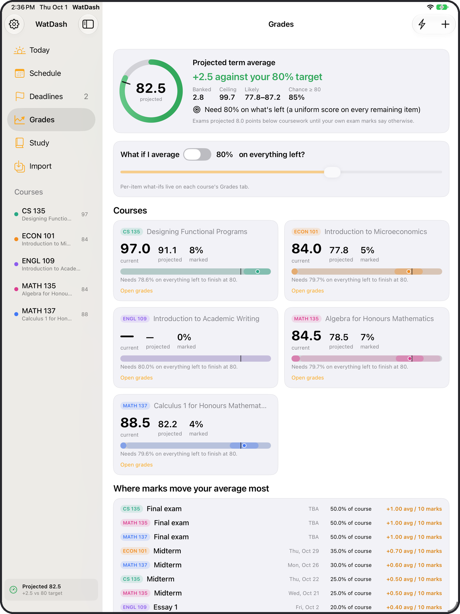
</p>

<sub>All screenshots use the built-in sample term (`-WatDashDemo`), not real
marks. The Mac shots come from the debug snapshotter, which can't draw the
translucent sidebar, so they're cropped to the content area.</sub>

## Highlights

- **One multiplatform SwiftUI target** for Mac, iPhone and iPad: sidebar and
  detail on Mac and iPad, tabs and stacked rows on iPhone.
- **A grade engine that works in Waterloo averages**, not GPA: whole-number
  rounding, drop-lowest, "final replaces midterm", exemptions, a projected
  range and the chance of clearing 80%.
- **Hand-written parsers** for RFC 5545 iCalendar (with recurrence), Quest
  schedules, course outlines and plain-English quick capture, all pure
  functions checked by `Tests/Checks.swift`.
- **One store, many projections**: every change fans out to WidgetKit
  widgets, notifications and an Apple Calendar export keyed by deterministic
  ids.
- **Mac extras**: a menu bar line ranked by urgency, a ⌃⌥Space quick-capture
  panel from any app, and App Intents for Siri, Shortcuts and Spotlight.

---

## What's in it

| Screen | What it does |
|---|---|
| **Today** | Answers "what should I be working on right now?" A **Focus** card leads with the most urgent item (overdue up to 48 hours, due in the next 48 hours, or a midterm or exam this week) and its countdown, then the rest of that list with done checkboxes. Below it, **Rest of today** lists only the classes still ahead. One-line notices appear only when the setup is unfinished or captures are waiting. No grades here: they're on Grades and in the sidebar. |
| **Schedule** | Week grid with a live "now" line, overlap-aware columns, click-to-inspect popovers ("skip this one" for a cancelled lecture), double-click to add. Agenda mode for the next four weeks. Office hours are an optional layer behind a switch (off by default; the same switch covers Today, the menu bar, widgets, course pages and Siri). |
| **Deadlines** | Overdue / this week / next week / later / TBA, with done checkboxes, marks, and on every quiz, midterm and exam a **Seat** button (your room and seat on Odyssey) and a study-prompt button. |
| **Grades** | Projected term average with a likely range, chance of clearing the target, the uniform score needed on everything left, a what-if slider, and per-item leverage ("+0.60 on your average per 10 marks"). |
| **Course** | Grading-scheme editor (weights, item counts, drop-lowest, exam flags, "final replaces midterm", "must pass the exams"), score table with per-item what-if sliders and exemptions, meetings, files, notes page map. |
| **Study** | Builds a ready-to-paste **Claude Code prompt** for a study page: assessment, sections, notes page ranges, course rules. No API key: Claude Code runs it on your subscription using the `quiz-prep` skill in the classes folder. |
| **Import** | Eight import tiles plus a list of every source with health, refresh and remove. |

Plus: a **menu bar** line (below) with a panel of what's due soon and what's
left of the day plus a capture field, **⌃⌥Space quick capture** from any app, **desktop widgets**, **Shortcuts/Siri/Spotlight actions**, deadline **notifications**,
optional **Apple Calendar** sync, and a two-way sync with **Syllabus on an
OS X 10.9 Mac** through a git repository (see [The Mac Pro](#the-mac-pro)).

### iPhone and iPad

The same app, laid out for the screen. A full-width iPad gets the Mac's
sidebar and detail; iPhone (and an iPad window narrow enough for the phone
layout, e.g. in Split View) gets tabs for Today, Schedule, Deadlines and
Grades, with Study, Import, the courses and Settings under More. On a phone,
Schedule shows a day at a time (or the agenda), the course editor's tables
become stacked rows, and quick capture and Settings are sheets.

What stays on the Mac: the menu bar line, the ⌃⌥Space hotkey, launch at
login, Finder buttons and the widgets. Widgets read their data through an App
Group, and on iOS a group has to be registered in a provisioning profile,
which a free personal team can't get (the same limit WatAlarm works around).

Each device keeps its own data file; nothing syncs between them yet. On iOS,
pick the classes folder in Files (Settings → General → Classes folder, e.g.
from iCloud Drive), or copy it into *On My iPhone › WatDash*, where it's
found without picking. Calendar files, Quest pastes, feeds and Apple Calendar
import work as on the Mac.

### The menu bar line

One line, recomputed every minute and on wake, in this order:

1. **The class you're in**, or a quiz you're writing: `ENGL 119 · 25m left`.
2. **A class starting within 30 minutes**: `ECON 101 in 12m`.
3. **The most urgent work**, when something is pressing: `CS 145 A4 · 3h 20m`, or `· late`.
   Urgency is *what it's worth × the work it needs ÷ the hours left*: its
   share of the course grade (from the grading scheme), a rough effort by kind
   (exam 12 h, midterm 8 h, assignment 4 h, quiz 2 h) and the time to the
   deadline. It counts as pressing at 0.25, which is about four and a half
   days before a 30% midterm, half a day before a typical assignment and a
   few hours before a small quiz. Late work (up to 48 hours) always counts.
4. **Otherwise the next assignment due**: `CS 145 A4 · Fri`.
5. Nothing in three weeks: just the icon.

The logic is pure (`Services/Urgency.swift`, `Services/MenuBarStatus.swift`)
and checked in `Tests/Checks.swift`.

## Getting your term in

Every import is remembered as a *source*. Re-importing updates in place (ids
are stable), and removing a source removes exactly what it added. Marks are
never deleted by an import.

| Source | Gives you | Notes |
|---|---|---|
| **Course folders** | Assessments with dates, coverage, rooms and posted marks, grading scheme, weekly office hours, notes page map, study pages, notes PDF, reading week, the course's help rules and accent colour | Reads each `<Course>/CLAUDE.md` under `~/Documents/University of Waterloo Classes` (format below). A saved outline in the folder adds class times for the sections you pick. On the Mac, an edit to any course's `CLAUDE.md` is re-read within a few seconds, without a click. |
| **Quest schedule** | Your actual class meetings | Copy Quest → Enroll → My Class Schedule → List View and paste; or use that page's *Download Schedule* `.ics`. |
| **Calendar file / feed** | Anything iCalendar | Feeds refresh on a timer. LEARN's Calendar → Subscribe feed and public Google office-hour calendars both work. A UW Flow schedule export (uwflow.com → Schedule → export) gives every lecture, tutorial and test slot; open the `.ics` with WatDash. |
| **Course outline** | Every section's times plus the assessment table | Save the outline.uwaterloo.ca page as HTML. |
| **Apple Calendar** | Calendars already on the Mac (Google, Outlook, iCloud) | Re-read whenever they change. |
| **Waterloo Open Data** | Class times for your sections, important dates, final exam slots, seat counts, campus events | Free key from openapi.data.uwaterloo.ca, kept in the Keychain. |
| **UW holidays** | Stat holidays that cancel classes | Anonymous feed; no key. |
| **Quick capture** | One line of plain English | `CS 135 OH Tue 2-3pm MC 4065 weekly until Dec 4`, `math137 quiz 4 oct 19`, `A4 due fri 11:59pm`. Unsure parses wait in the inbox. |

### The course-folder `CLAUDE.md`

The same file briefs Claude and fills the dashboard. What WatDash reads:

- `# MATH 137: Calculus 1 for Honours Mathematics (Fall 2026)`: code, title, term. "(self-study)" in the heading marks a course that never counts.
- Under `## Assessments…`, grading bullets: `- Quizzes, 20%, best 9 of 10: …`, `- Midterm 2, 20%: …`. Sentences like "Assignments are due Wednesdays at 4:05 PM" set default times.
- Any table with *Assessment* and *Date* columns: one assessment per row. Optional columns: *Covers* / *Sections* (coverage), *Room* (room and seat), *Mark* (`15/19`, `91.67%`, or `Submitted`), *Status* (`Submitted`, `Written`, `Done`). A posted mark only fills an empty score; marks typed in the app win.
- `## Office hours`: one quick-capture line per weekly slot, e.g. `- Tue 11:30am-12:30pm MC 5473, Troy Vasiga, weekly until Dec 8`.
- "Reading week is Oct 10–18.", `## Study pages` links, a "blue accent" colour, and the notes PDF under `## Files`.

An item named after a component maps to it ("Midterm 2" → *Midterm 2*, "Skills challenge 1" → *Skills challenges*); otherwise the kind picks one ("Quiz 3" → *Quizzes*).

Timetable test slots (UW Flow and Quest `TST`) are hidden where the course's own quiz or exam already sits, and a quiz written in the tutorial slot replaces that tutorial, since the seat on Odyssey is usually somewhere else.

Holidays and reading week cancel **class meetings** and office hours only.
Deadlines during reading week still stand.

## The Mac Pro

A 2013 Mac Pro on OS X 10.9 runs **Syllabus**
(`~/Documents/Mavericks Projects/Syllabus`), which shows this calendar with
no browser and no modern HTTPS. The two talk through the classes folder's
private GitHub repository: WatDash writes the calendar there, already worked
out, and the Mac Pro writes back small notes. Turn it on in Settings →
Calendar → Mac Pro; the same section shows "Mac Pro sync: last pushed …" or
what went wrong, and has Sync Now.

- **Its own clone.** WatDash works in a clone of its own, in
  `~/Library/Application Support/WatDash/MacPro/Study`, made from the classes
  folder's `origin` remote (Settings can name another). Your working copy of
  the classes folder, and anything uncommitted in it, is never touched.
- **What it may change.** It writes `Calendar/watdash.json` and deletes notes
  in `Inbox/`. Every commit is checked before it's pushed, and anything else
  is refused.
- **When.** A few seconds after the store changes (including a course
  `CLAUDE.md` being edited, which the folder watcher re-reads), every five
  minutes, and after the Mac wakes. Each pass pulls with rebase, applies the
  notes, writes the export if anything changed, commits as "WatDash
  (MacBook)", and pushes, rebasing again if the Mac Pro pushed meanwhile.
- **Safely.** git runs with no terminal and nothing that can prompt, in its
  own process group, killed after a timeout. Offline, a pass fails quietly,
  says so in Settings, and the next one catches up. A note applied before a
  push failed is remembered, so it is never applied twice.
- Only the real store syncs: never the sample term or a scratch file.

### `Calendar/watdash.json`, version 1

One JSON object; keys sorted, so the same calendar is the same bytes.
Times are Waterloo wall-clock strings (`"2026-10-19 17:30"`), days are
`"2026-10-19"`. It covers the Monday a week back to the end of exams.

| Key | What |
|---|---|
| `format`, `version` | `"watdash-calendar"`, `1`. A reader refuses a newer major version. |
| `exported` | When this content was first written. Unchanged content keeps its time. |
| `timeZone`, `term`, `from`, `to` | `America/Toronto`, the term's name, the first and last day covered. |
| `officeHours` | Whether office hours are in it (WatDash's office-hours switch). |
| `courses[]` | `code`, `title`, `color` (`#RRGGBB`), `folder` (in the repository, e.g. `Math137`), `notesFile` (e.g. `Math137/MATH_137.pdf`). |
| `classes[]` | Every class meeting, office hour and event as a dated occurrence, with holidays, reading week, skipped lectures and replaced test slots already applied: `id`, `course`, `title`, `kind`, `start`, `end`, `room`. |
| `allDay[]` | All-day items (reading week, holidays): `id`, `course`, `title`, `kind`, `first`, `last` (inclusive). |
| `deadlines[]` | Quizzes, tests, exams, assignments and deadlines: `id`, `course`, `title`, `kind`, `due` (missing when TBA), `end` (the writing window; missing for a point in time), `covers`, `room`, `seat`, `detail`, `done`, `canTick`, `seated` (Odyssey has the seat), `sections[]` (`section`, `title`, `page`: the notes sections it covers, from the course's page map). |
| `notes[]` | The last 30 days of notes from the Mac Pro: `file`, `note`, `result` (`applied`, `inbox`, `unknown`, `failed`, `unreadable`), `message`, `when`. |

Ids are WatDash's own and stable: `<event id>@<start in Unix seconds>` for an
occurrence, `assessment:<uuid>` for an assessment, the same in every export
until the item itself is deleted. Only `assessment:` deadlines can be ticked
(`canTick`); a marked one can't be unticked.

A change that would break a reader bumps `version`; adding a key doesn't.

### `Inbox/`: notes from the Mac Pro

One note per file, `Inbox/<date>-<time>-<random>.txt`, added and never
edited by the Mac Pro:

```
done: assessment:6F1D2C4A-…
written: 2026-10-10 14:03
from: Syllabus on the Mac Pro
```

| Note | WatDash does |
|---|---|
| `capture: <one line>` | Quick capture, exactly as typed into the capture panel (with the on-device model when it's on). "Tomorrow" counts from `written:`. An unsure one waits in the inbox as usual. |
| `done: <id>`, `undone: <id>` | Ticks or unticks that assessment. |

Then it deletes the file and reports the result in the next export's
`notes`, which is how the Mac Pro knows a tick it sent has landed.

## The grade engine

The Faculty of Math rule (CS advising FAQ): students with a **cumulative
average of at least 80%** can take six courses; below that you can petition.
So the engine works in Waterloo averages, not GPA:

- unit-weighted mean of **whole-number** course grades (rounding modelled)
- CR/NCR and self-study courses excluded
- drop-lowest applied only once there are more marks than kept slots
- "final replaces midterm" and "must pass the exams" rules
- exemptions shift weight to the rest of the component

For each course it reports **banked** (zeros on everything left), **ceiling**
(100s), **current**, **projected** and the **uniform score needed**. Projection
fills unwritten work with your own component average; exams are projected
`examGap` points lower (default 8), a prior that is replaced by the gap
learned from your own marks once there are exam results. The spread and the
chance of clearing the target come from a per-slot variance (exams wider than
coursework), which is rough and meant as a range rather than a promise.

In your first term the cumulative average *is* this term's average, so the
overload tracker is the number that decides Winter.

## Architecture

```
Sources ──► Importers (pure parsers) ──► AppStore (one JSON file) ──► Projections
            ICSParser, QuestSchedule-     canonical store:            SnapshotWriter → widgets
            Parser, OutlineParser,        courses, events,            NotificationScheduler
            CourseFolderParser,           assessments, sources,       CalendarSync (EventKit)
            QuickCaptureParser            settings                    MacProSync (git → Syllabus)
                                                                      views, menu bar, intents
                                               │
                                     RecurrenceExpander, GradeEngine (pure)
```

```
Shared/            compiled into the app AND the widget extension
                   (snapshot model, palette, App Group id)
WatDash/
  App/             app entry, delegate, App Intents, debug snapshotter
  Core/            logging, deterministic ids, keychain, Waterloo time
  Models/          Course, DashEvent, Assessment, GradeScheme, DataSource, AppData
  Importers/       the parsers — no UI, no store, no clock
  Services/        store-facing work: imports, EventKit, notifications, hotkey,
                   smart capture, Open Data, study prompts, grade engine
  Store/           AppStore
  Views/           SwiftUI, one set for every platform: `\.isCompact` (iPhone
                   and narrow iPad windows) picks tabs and stacked rows;
                   `#if os(macOS)` fences what only a Mac has
WatDashWidgets/    Up Next, Deadlines, Overload Tracker, Today (macOS)
Tests/Checks.swift assertions on parsers, recurrence, grades and study prompts
Tools/             project generator, checks runner, icon generator, installer
```

Design decisions worth knowing:

- **One store, many projections.** Every mutation goes through
  `AppStore.commit`, which saves (debounced) and refreshes the widget
  snapshot, notifications and the Apple Calendar export. Nothing is ever
  "the calendar" — calendars are rebuildable views.
- **Deterministic ids everywhere** (as in WatAlarm). Exported Calendar events
  carry `watdash://occurrence/<digest>` of what they are; reconciliation is a
  set difference; WatDash only ever touches events it created.
- **The clock ticks on the minute.** `AppStore.now` moves at each minute
  boundary, where every class starts and ends, from a one-shot timer that is
  rescheduled from the wall clock each time (a timer's deadline doesn't
  advance while the Mac sleeps), and again on wake and on clock or time-zone
  changes. The menu bar label is computed in the App's scene body, so the
  scene itself depends on the clock.
- **Writes that change nothing are dropped.** Observation fires on every
  write, and SwiftUI bindings (the menu bar's `isInserted`, toggles) re-set
  identical values; without the guard in `AppStore.settings` that loops.
- **The on-device model only normalizes language.** With Apple Intelligence
  on, messy captures go through `FoundationModels` guided generation into
  fields copied *as written*; dates are always computed by the deterministic
  parser, which is tested.
- **The widget never reads the store.** The app writes a small snapshot into
  the App Group container; the widget builds timeline entries at every class
  boundary and every 15 minutes, so "Up next" advances without the app.

## Building

Requires Xcode 27 with the macOS 26 and iOS 26 SDKs. One multiplatform target
builds for all three.

```bash
python3 Tools/generate_project.py   # after adding or removing files
./Tools/run_checks.sh               # pure-logic checks, no Xcode project needed
./Tools/install.sh                  # Release build → /Applications, then launches it
```

For iPhone or iPad, open `WatDash.xcodeproj` and pick a simulator or your
device, or from the command line:

```bash
xcodebuild -project WatDash.xcodeproj -scheme WatDash -destination 'platform=iOS Simulator,name=iPhone 17 Pro' build
```

### Signing

Manual signing with your **Apple Development** identity and **no provisioning
profile**, which macOS allows for everything WatDash uses: App Sandbox (widget
only), an App Group named `<TEAM>.com.ashwinpaudel.WatDash` (team-prefixed
groups need no registration on macOS), calendar access and network access.
That means a free personal team works, and unlike an iOS build there's **no
7-day expiry**. Use `--team` to build under a different team.

iOS signs automatically with the same team and needs no entitlements (no App
Group, since the widgets are Mac-only). A free team works on your own devices
with Apple's 7-day profiles; the simulator needs no signing at all.

### Debug helpers

```bash
WatDash.app/Contents/MacOS/WatDash -WatDashDemo                      # sample term in its own data file
WatDash.app/Contents/MacOS/WatDash -WatDashStore scratch             # any scratch data file
WatDash.app/Contents/MacOS/WatDash -WatDashStore scratch -WatDashScanFolders
WatDash.app/Contents/MacOS/WatDash -WatDashDemo -WatDashSnapshot /tmp/shots   # PNG of every screen, then quit
WatDash.app/Contents/MacOS/WatDash -WatDashDemo -WatDashStore rt -WatDashMacProTest <repo> <clone>   # one Mac Pro sync, then quit
```

The last is the WatDash half of Syllabus's `make roundtrip`: one sync pass
against a local repository, with a scratch store.

Data lives in `~/Library/Application Support/WatDash/watdash.json`, with a
rolling daily backup next to it (on iOS, in the app's own Application
Support). API keys live in the Keychain. A scratch store (`-WatDashStore`)
never touches the widgets, reminders or Apple Calendar, which it would
otherwise share with the installed app. The same flags work on a simulator:
`xcrun simctl launch booted com.ashwinpaudel.WatDash -WatDashDemo`.

## License

MIT. See [LICENSE](LICENSE).
